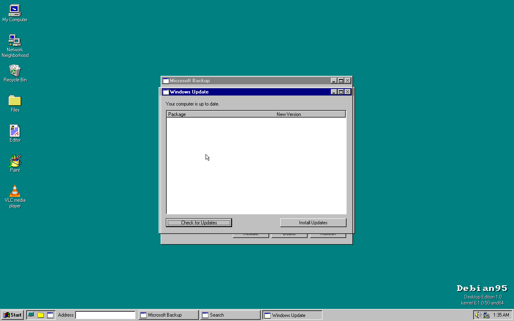
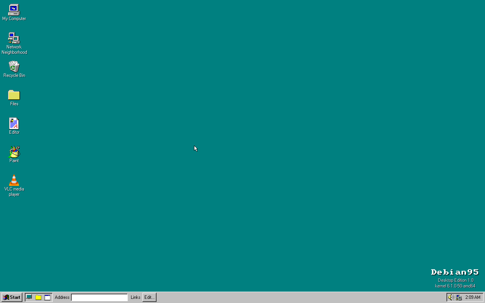

# Debian95

A functional **Windows-95-style desktop** on **Debian 12** — the Win95 shell (window
manager, taskbar, Start menu, icons, MS Sans Serif, 3D chrome) as one original C
codebase, running real Linux apps (VLC, Chromium, PCManFM, …) reparented into Win95
chrome with taskbar buttons.

## Screenshots





*Real screenshots, captured from a headless QEMU boot.*

## What it is

- **The shell** (`subsystems/win32`, shared C): the Win95 desktop. Every built-in
  "app" — Explorer, Notepad, Paint, Calculator, Minesweeper, Solitaire, Media
  Player, Control Panel, Registry Editor, Task Manager, Services … — is a C function
  that opens a window in a single-process compositing WM. Built as
  `debian95-desktop-sdl`, it runs as the X session.
- **The window manager** (`usermode/debian95-wm`): a reparenting X11 WM that wraps
  real Linux apps in Win95 chrome (title bar, min/max/close, drag, focus-aware and
  themeable coloring) and puts them on the shell's taskbar (via EWMH).
- **The Windows Environment Layer**: Control Panel drives the real system — apt
  (Add/Remove Programs), systemctl (Services), /proc (Task Manager), nmcli (Wi-Fi),
  useradd (Users), lp (printing), PipeWire/ALSA (Volume), lsblk/udisks (drives).
- **Launching**: downloaded apps start from a desktop icon or Start > Programs
  (never a script), forked with dropped privileges.

## Build & run (WSL2 / Linux + QEMU)

One command builds everything — Debian rootfs (with firmware + a signed Secure Boot
chain), the WM + desktop, system integration, and the bootable UEFI image:

```bash
bash tools/build-debian95.sh amd64
# -> ~/debian95/debian-amd64/debian95-usb.img
```

Then boot it, or flash it:

```bash
bash tools/run-usb.sh amd64      # boot the image under real UEFI firmware (OVMF) in QEMU
bash tools/run-debian.sh amd64   # or a quick direct-kernel boot (skips the bootloader)
```

Flash `debian95-usb.img` to a USB stick with **balenaEtcher**, **Rufus**, or
`dd if=~/debian95/debian-amd64/debian95-usb.img of=/dev/sdX bs=4M status=progress`.

The whole OS is declared in **`debian95.conf`** (arch, suite, firmware policy, the
services the shell fronts, preinstalled apps, theme) — edit it and rebuild.

<details><summary>Individual build steps (what build-debian95.sh runs)</summary>

```bash
bash tools/mk-debian.sh amd64              # Debian rootfs tarball (firmware + signed boot)
MKDEB_FRESH=1 bash tools/mk-debian-image.sh amd64   # extract it
bash tools/build-debian95-wm.sh amd64       # the reparenting X11 WM
bash tools/build-debian95-desktop.sh amd64  # the Win95 desktop shell
bash tools/setup-plymouth.sh amd64         # boot splash
bash tools/setup-audio.sh amd64            # PipeWire stack
bash tools/setup-persistence.sh amd64      # first-boot grow-to-fill-the-stick
bash tools/debian-xsession.sh amd64        # autologin + desktop as the X session
bash tools/mk-debian-image.sh amd64        # pack the ext4
bash tools/mk-usb.sh amd64                 # assemble the signed GPT/UEFI image
```
</details>

## Booting on real hardware

- **Secure Boot** works either on or off: the image ships Microsoft-signed `shim`
  chainloading Debian-signed GRUB.
- **Safe Mode**: hold **Esc** (or Shift) at boot to show the GRUB menu, then pick
  *Debian95 (Safe Mode – text console)* — it boots `nomodeset` to a root shell
  instead of the desktop, for recovering a machine whose GPU/X won't come up.
- **Rescue consoles**: **Ctrl+Alt+F2 / F3** give a text login even when the desktop
  owns tty1 (root password: `debian95`).
- **Persistence**: on first boot the root partition grows to fill the whole stick.

## Layout

```
subsystems/win32/  the shared desktop: window manager, apps, controls, dialogs, theme
usermode/desktop/  the Linux platform layer (SDL2/X11), shims, terminal, X11 bridge
usermode/debian95-wm/  the reparenting X11 window manager (Win95 chrome on real apps)
drivers/           framebuffer + image/video codecs (png qoi gif jpeg mpeg-1)
lib/rtl/           fonts + freestanding runtime pieces the desktop reuses
sdk/include/       public headers (Debian95's own API)
third_party/       picojpeg (JPEG) + plmpeg (MPEG-1)
assets/            icons, fonts (ui.fon → FONT.LGF), wallpapers, test media
tools/             Debian rootfs + image + USB builders, asset/font builders
```

## Status

Boots to a full Win95 desktop on Debian (in QEMU or off a UEFI USB stick), with real
extracted Win95 icons, MS Sans Serif, and 3D chrome.

- **Shell**: draggable icons on a 75×75 grid (labels wrap, drop snaps to grid),
  taskbar with a Quick Launch toolbar and per-window buttons, cascading Start menu,
  hover tooltips, right-click menus, Alt+Tab, themes (95/98/XP/Flat).
- **First run / login**: OOBE setup wizard, optional password login, the "Did you
  know…" Welcome tips.
- **Apps** (built-in, single-process compositing WM): Explorer, Notepad, Paint,
  WordPad, Calculator, Character Map, Media Player, Sound Recorder, Minesweeper,
  Solitaire, FreeCell, Clock, Registry Editor, Task Manager, Services, and
  **System Tools** (ScanDisk + Disk Defragmenter with the animated grids).
- **Control Panel** wired to the real system: Display (wallpaper, themes, screen
  savers — Mystify/Starfield/Pipes/Flying Windows), Add/Remove Programs (apt),
  Network (nmcli Wi-Fi), Sounds, Users, Date/Time, Regional, Keyboard, Mouse,
  Accessibility, Passwords.
- **"What's This?"** (`?`) context help on dialogs; the classic shutdown sequence
  ("It is now safe to turn off your computer").
- **Real downloaded apps** — VLC, Chromium, a file manager, an image viewer —
  running framed with Win95 title bars, focus-aware and theme-matched, auto-discovered
  into Start > Programs.
- **Hardware-ready**: firmware blobs, signed Secure Boot, Safe Mode + rescue
  consoles, USB persistence.
